<div align="center">




<a href="https://3bdomos2afa.github.io"></a>


<a href="https://github.com/3bdomos2afa">
  
</a>

</div>

---

## 🎯 About Me

<table>
<tr>
<td width="62%">

```js
const abdelrahman = {
  role: "CS Student & Mobile/Web Developer",
  university: "Sinai University",
  location: "10th of Ramadan City, Egypt 🇪🇬",

  building: [
    "SU-student (Expo / React Native)",
    "Real-Estate-Website",
    "Code Hub",
  ],

  tech: {
    mobile: ["React Native", "Expo"],
    web: ["React", "Vite", "TypeScript", "Tailwind"],
    backend: ["Node.js", "PostgreSQL"],
  },

  motto: "shipping > perfecting",
};
```

</td>
<td width="38%" align="center">


</td>
</tr>
</table>

> *"Make it work, make it right, make it fast."* — Kent Beck

---

## 🔗 Connect With Me

<div align="center">

[](https://3bdomos2afa.github.io)
[](https://github.com/3bdomos2afa)

</div>

---

## 🛠️ Tech Stack

<div align="center">


<br/><br/>


</div>

---

## 📂 Featured Projects

<div align="center">

<a href="https://github.com/3bdomos2afa/SU-student"></a>
<a href="https://github.com/3bdomos2afa/Real-Estate-Website"></a>
<a href="https://github.com/3bdomos2afa/3bdomos2afa.github.io"></a>
<a href="https://github.com/3bdomos2afa/Code-Hub-Learn-Code-Challenge-Hub"></a>

</div>

<details>
<summary><b>📱 SU-student, features & highlights</b></summary>

Student portal app built with Expo / React Native. Offline-first, Arabic and English, glass UI. [Repo](https://github.com/3bdomos2afa/SU-student) · [Demo](https://su-student-ivory.vercel.app/)

</details>

<details>
<summary><b>🏠 Real-Estate-Website, features & highlights</b></summary>

Real estate listing website. [Repo](https://github.com/3bdomos2afa/Real-Estate-Website) · [Demo](https://real-estate-website-nu-seven.vercel.app/)

</details>

<details>
<summary><b>💻 Code Hub, features & highlights</b></summary>

Interactive coding-challenge learning hub. [Repo](https://github.com/3bdomos2afa/Code-Hub-Learn-Code-Challenge-Hub)

</details>

---

## 📊 GitHub Analytics

<div align="center">


</div>

## 🐍 Contribution Snake

<div align="center">

<picture>
  <source media="(prefers-color-scheme: dark)" srcset="https://raw.githubusercontent.com/3bdomos2afa/3bdomos2afa/output/github-snake-dark.svg" />
  <source media="(prefers-color-scheme: light)" srcset="https://raw.githubusercontent.com/3bdomos2afa/3bdomos2afa/output/github-snake.svg" />
  
</picture>

<br/><br/>

طالب ومبرمج في جامعة سيناء 🇪🇬


</div>
