 

## ☕ المنيو

## 🪑 أطباق اليوم (مشاريعي)

| Project | What it is | Links |
| --- | --- | --- |
| 📱 **SU-student** | Student portal app. Expo/React Native, offline-first, Arabic & English, glass UI | [Repo](https://github.com/3bdomos2afa/SU-student) · [Demo](https://su-student-ivory.vercel.app/) |
| 🏠 **Real-Estate-Website** | Real estate listing website | [Repo](https://github.com/3bdomos2afa/Real-Estate-Website) · [Demo](https://real-estate-website-nu-seven.vercel.app/) |
| 🌐 **Portfolio** | My personal website | [Repo](https://github.com/3bdomos2afa/3bdomos2afa.github.io) · [Live](https://3bdomos2afa.github.io) |
| 💻 **Code Hub** | Interactive coding-challenge learning hub | [Repo](https://github.com/3bdomos2afa/Code-Hub-Learn-Code-Challenge-Hub) |

## 🧰 العدة

## 🧾 الحساب (GitHub stats)

## 🐍 الثعبان اللي بيلف على القهوة

<picture>
  <source media="(prefers-color-scheme: dark)" srcset="https://raw.githubusercontent.com/3bdomos2afa/3bdomos2afa/output/github-snake-dark.svg" />
  <source media="(prefers-color-scheme: light)" srcset="https://raw.githubusercontent.com/3bdomos2afa/3bdomos2afa/output/github-snake.svg" />
  
</picture>

## 📫 تواصل معايا

 

طالب ومبرمج في جامعة سيناء 🇪🇬 ، والقهوة على حسابي ☕

